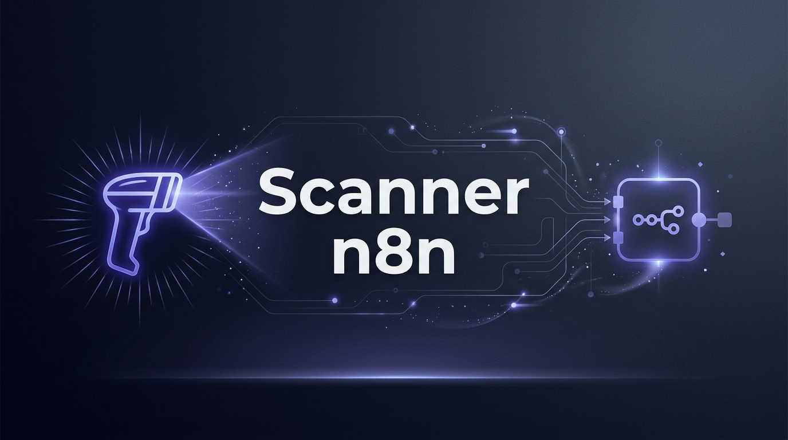

<p align="center">
  
</p>

<p align="center">
  <strong>Desktop application to connect a Bluetooth barcode scanner to n8n via webhook</strong>
</p>

<p align="center">
  <a href="#features">Features</a> •
  <a href="#installation">Installation</a> •
  <a href="#usage">Usage</a> •
  <a href="#n8n-configuration">n8n Configuration</a> •
  <a href="#compilation">Compilation</a> •
  <a href="#license">License</a>
</p>

<p align="center">
  
  
  
  
</p>

---

> 🇫🇷 **Guide pas à pas (opérateur + n8n/Notion)** : [docs/GUIDE-UTILISATION.md](docs/GUIDE-UTILISATION.md)

## About

**n8n Scanner** is a lightweight desktop application written in Rust that turns a Bluetooth scanner (like the Netum CS7501) connected via **SPP (Serial Port Profile)** into a stock-movement station. It captures `IN|REF` / `OUT|REF` QR codes, counts quantities locally, and forwards one durable event per movement to an **n8n** workflow via HTTP webhook.

The application features a modern graphical interface with dark/light themes, a persistent outbox, a local reference catalog, and a real-time activity log.

---

## Features

- 🔌 **Auto-detection** of serial ports (COM on Windows, `/dev/cu.*` on macOS).
- 📡 **Smart serial listening** with chunk splitting, 50ms timeout, and 100ms idle timeout (no dependency on `\n` terminators). Several codes in one chunk are processed separately.
- 🏷️ **Two-QR stock movements**: `IN|REF-001` receives stock, `OUT|REF-001` withdraws stock. The QR contains no quantity.
- 🔢 **Quantity by scan**: the first scan sets quantity to 1; scanning the same code again increments it. The numeric keypad overrides the quantity, `Enter` validates, `Esc` cancels, and scanning another reference validates the pending movement.
- ⏱️ **Auto-validation** after 5 seconds of inactivity, with a visible countdown.
- ✋ **Cancel the current entry** without sending anything to n8n: on-screen button, `Esc`, or a printed `ANNULER` QR code. The app writes it as a standalone `qr-annulation.svg` file (22 mm) next to its configuration, ready to import into thermal label software for 50 × 30 mm labels.
- ↩️ **10-second undo** for the last movement.
- 💾 **Persistent outbox**: every movement is written to `outbox.json` before HTTP, then replayed sequentially with retries and a stable `event_id` for idempotency.
- 📚 **Local reference catalog** loaded from `references.csv` (names and descriptions only) for instant display; stock and alerts remain exclusively in Notion.
- 📊 **KPI Dashboard**: movements, validated, pending, rejected.
- 📜 **Activity Log** with color-coded severity levels (Info, Success, Warning, Error, Raw).
- 🔄 **Real-time URL sync**: Edit the webhook URL without stopping the capture process.
- 🎛️ **Focused operator view**: webhook settings live in **⚙ Paramètres** and serial/Bluetooth settings in **🔌 Connexion**, so the main screen only shows scanning.
- 🧪 **Webhook test button** to validate network connection before scanning.
- ⚡ **Built-in n8n assistant**: Detects if the URL is in test mode (`/webhook-test/`) and offers a 1-click switch to production (`/webhook/`).
- 🔐 **Optional API key** sent as the `X-Scanner-Key` header.
- 💾 **Persistence**: User configuration is automatically saved in `scanner_config.json`.
- 🖥️ **Cross-platform**: macOS universal (Apple Silicon + Intel) and Windows (cross-compiled).

---

## Installation

### Pre-compiled Binaries

Download the appropriate binary for your OS from the [Releases](../../releases) page:

| OS | File | Architecture |
|---|---|---|
| **macOS** (Apple Silicon + Intel) | `Scanner-n8n-<version>-universal.dmg` | universal (arm64 + x86_64) |
| **Windows** | `Scanner-n8n-Setup-<version>-x64.exe` | x86_64 |
| **macOS** (bare binary) | `Scanner-n8n-<version>-universal` | universal |
| **Windows** (bare binary) | `scanner_n8n.exe` | x86_64 |

The macOS universal build runs on Apple Silicon (macOS 11 or newer) and Intel
Macs (macOS 10.14 or newer).

### From Source

```bash
# Requirement: Rust 1.85+
curl --proto '=https' --tlsv1.2 -sSf https://sh.rustup.rs | sh

# Clone and compile
git clone https://github.com/<your-username>/scanner_n8n.git
cd scanner_n8n
cargo build --release

# The binary will be located in target/release/scanner_n8n
```

---

## Usage

### 1. Prepare the Scanner

> **Important**: The scanner must be set to **SPP (Serial Port Profile)** mode, NOT HID (keyboard) mode.

For the **Netum CS7501**:
1. Scan the **"Bluetooth SPP Mode"** barcode found in the scanner's manual.
2. Pair the Bluetooth scanner with your computer.
3. The scanner will now appear as a serial port:
   - **macOS**: `/dev/cu.CSbarcodescanner` (or similar)
   - **Windows**: `COM3`, `COM4`, etc.

### 2. Launch the Application

```bash
# From source
cargo run

# Or directly run the binary
./target/release/scanner_n8n      # macOS
scanner_n8n.exe                    # Windows
```

### 3. Configuration

The webhook and hardware settings live in two dialogs opened from the header, so
the operator view stays focused on scanning:

- **⚙ Paramètres**: webhook URL, station / device ID, API key, webhook test;
- **🔌 Connexion**: serial port, baud rate, start-capture-at-launch.

1. In **⚙ Paramètres**, paste your n8n webhook URL (use the **production** version: `https://your-n8n/webhook/...`).
2. Set the **Station / Device ID**: a stable identifier for this workstation (for example `POSTE-01`).
3. **API key** (optional): if your n8n workflow uses Header Auth, the app sends it as `X-Scanner-Key`.
4. In **🔌 Connexion**, select your scanner's **serial port** from the dropdown list.
5. **Baud Rate**: generally `9600` (default) or `57600`.
6. Check **"Start capture at launch"** if the station should be ready after a reboot.
7. Click **"▶ Start Capture"**. The header badge switches to **● ACTIF**.

Settings are saved automatically:
- **macOS**: `~/Library/Application Support/scanner_n8n/scanner_config.json`
- **Windows**: `%APPDATA%\scanner_n8n\scanner_config.json`
- **Development**: `./scanner_config.json` when present
- **Override**: set `SCANNER_N8N_CONFIG=/path/to/scanner_config.json`

Optional tuning in `scanner_config.json` (restart the app after changing):
- `auto_commit_secs`: idle delay before auto-validation (default `5`).
- `debounce_ms`: double-read debounce for the same QR (default `300`).

For production diagnostics, set `SCANNER_N8N_LOG_FILE=/path/to/scanner.log` before
launching the app; the activity log is then also appended to that file.

To make the station ready after a reboot, add the app to **macOS Login Items**
(System Settings → General → Login Items) or to the **Windows Startup folder**
(`shell:startup`), and enable **"Start capture at launch"** in the app.

### 4. Stock mode

The app expects **one QR code for the action and one for the reference**:

| QR content | Meaning |
|---|---|
| `IN|DCO001` | Receive one or more pieces of `DCO001` into stock |
| `OUT|DCO001` | Withdraw one or more pieces of `DCO001` from stock |

The QR contains **no quantity**. Quantity is counted by the app:

1. The first scan creates a pending movement with quantity **1**.
2. Scanning the same QR again increments the quantity by one (300 ms debounce against double reads).
3. The numeric keypad can replace the quantity: type `4`, then `Enter`.
4. `Enter` validates immediately; `Esc` cancels.
5. Scanning **another** reference validates the pending movement automatically.
6. After **5 seconds** without input, the movement is validated automatically.

A **10-second undo** button is available after validation. If the movement is still queued locally, it is removed without HTTP; if it was already sent, a compensating movement is enqueued with `motif: "Annulation"` and `cancels_event_id`.

### 5. Local catalog (names only)

`references.csv` gives the app the reference name and description. It is generated from the Notion CSV export:

```bash
python3 scripts/import-notion-csv.py "Suivi de stock - pièces.csv" -o references.csv
```

Place `references.csv` next to the configuration file (or in the current directory during development), or set `SCANNER_N8N_CATALOG=/path/to/references.csv`.

The app does **not** keep a local stock cache and does **not** compute low-stock alerts. Stock and alerts are managed only in Notion; the optional `stock_after` returned by n8n is displayed as the server-side “Stock Notion” value after a movement. Existing CSV files that still contain `stock`, `stock_en_cours`, or `low_stock` columns remain compatible: those columns are ignored.

The catalog is optional: without `references.csv`, scanning and sending still work; the app simply displays the raw reference instead of a friendly name.

### 6. Labels

Labels are produced **outside the application**, for example with the label
software of a 3D printer. The app only requires the QR payload described above:

- `IN|REF` for a stock receipt;
- `OUT|REF` for a stock withdrawal.

The QR contains **no quantity and no stock level**, so a label stays valid when
stock changes. Use the exact reference from `references.csv` / Notion, and test
the first printed label with the scanner.

The **cancel** label is the only one the app helps with: at startup it writes
`qr-annulation.svg` (22 mm, payload `ANNULER`) next to `scanner_config.json`.
Import that SVG into the thermal label software on a **50 × 30 mm** layout; the
app never opens a print dialog.

- **macOS**: `~/Library/Application Support/scanner_n8n/qr-annulation.svg`
- **Windows**: `%APPDATA%\scanner_n8n\qr-annulation.svg`

---

## n8n Configuration

### Creating the Workflow

1. In n8n, create a new workflow.
2. Add a **Webhook** node.
3. Set Method to `POST`.
4. Copy the **Production URL** (the one without `-test`).
5. **Activate the workflow** (toggle in the top right corner → Green).
6. Paste the URL into the n8n Scanner application.

### Payload received by n8n

The app sends **one event per movement**, not one per piece. The legacy fields
(`barcode`, `timestamp`, `device_id`) are kept for compatibility; new workflows
should use the movement fields.

```json
{
  "event_id": "3f1c9e2a-7b4d-4e8f-9c1a-2d6b8e0f4a11",
  "seq": 42,
  "sku": "DCO001",
  "action": "OUT",
  "qty": 4,
  "station_id": "POSTE-01",
  "scanned_at": "2026-10-26T10:00:00+00:00",
  "raw": "OUT|DCO001",
  "app_version": "1.2.5",
  "barcode": "OUT|DCO001",
  "timestamp": "2026-10-26T10:00:00+00:00",
  "device_id": "POSTE-01",
  "motif": null,
  "cancels_event_id": null,
  "is_test": null
}
```

The header `Idempotency-Key` contains the same value as `event_id`. The n8n
workflow must store or check `event_id` before writing, so a retry after a
timeout cannot create a duplicate movement. If an API key is configured, the
header `X-Scanner-Key` is also sent.

### Expected response

Respond **after** the Notion write, not in "Respond Immediately" mode. The app
sends one event at a time, so a slow workflow delays the queue but does not
block scanning.

```json
{
  "ok": true,
  "stock_after": 38,
  "message": "Sortie enregistrée"
}
```

If the stock is insufficient, return HTTP **409** with:

```json
{
  "ok": false,
  "code": "INSUFFICIENT_STOCK",
  "available": 2,
  "message": "Stock insuffisant pour DCO001"
}
```

The app then reopens the pending movement with the rejected quantity so the
operator can adjust it without rescanning. Auto-validation and new scans are
paused until the quantity is adjusted (or the movement is cancelled), to avoid
replaying the same rejected movement. Any 2xx response without a JSON body is
treated as success (backward compatibility with the previous workflow); the app
does not keep a local stock cache.

### n8n implementation notes

1. Add a **Webhook** node (`POST`).
2. Validate `event_id` (idempotency) and `X-Scanner-Key`.
3. Reject `is_test: true` before writing to Notion; the test payload is
   `TEST-SCAN-123456`.
4. Read/write the Notion **Références** database and append to **Mouvements**.
5. Return the JSON response above.
6. Keep the app-to-n8n contract stable: a future migration from Notion to
   Postgres/Supabase should only change the n8n subworkflow, not the desktop app.

### ⚠️ Test vs Production URLs

| Type | URL | When it works |
|---|---|---|
| **Test** | `https://.../webhook-test/<id>` | Only when you click "Listen for test event" in the n8n editor |
| **Production** | `https://.../webhook/<id>` | 24/7, as long as the workflow is activated |

> **If you receive a 404 Error**, ensure you are using the **production** URL (`/webhook/`) and that the workflow is **active**.

---

## Compilation

### macOS (native development build)

```bash
cargo build --release
# → target/release/scanner_n8n (only the current architecture)
```

For a distributable universal build, use the packaging section below.

### Windows (cross-compilation from macOS)

```bash
# Install prerequisites (one time only)
rustup target add x86_64-pc-windows-gnu
brew install mingw-w64

# Compile
RUSTC=~/.rustup/toolchains/stable-aarch64-apple-darwin/bin/rustc \
~/.rustup/toolchains/stable-aarch64-apple-darwin/bin/cargo build \
--release --target x86_64-pc-windows-gnu

# → target/x86_64-pc-windows-gnu/release/scanner_n8n.exe
```

---

## Packaging

### macOS — universal `.app` + DMG

```bash
# One-time setup for the two architectures
rustup target add aarch64-apple-darwin x86_64-apple-darwin

./scripts/package-macos.sh
# → dist/Scanner n8n.app
# → dist/Scanner-n8n-<version>-universal.dmg
# → dist/Scanner-n8n-<version>-universal      (bare universal binary)
```

- The DMG contains a universal binary: Apple Silicon (arm64, minimum macOS 11)
  and Intel (x86_64, minimum macOS 10.14).
- Ad-hoc signature by default. For a Developer ID signature:
  ```bash
  APPLE_SIGNING_IDENTITY="Developer ID Application: ..." ./scripts/package-macos.sh
  ```
- The `.app` uses `assets/icon-dark.icns` as its Finder icon; the running app switches between the dark/light Dock icons automatically.
- Notarization is not automated. A downloaded non-notarized app may require right-click → Open, or `xattr -cr "/Applications/Scanner n8n.app"`.
- The bundle identifier can be overridden with `BUNDLE_ID=...`.

### Windows — installateur NSIS

Prerequisites: the cross-compilation toolchain (see above) and NSIS.

```bash
brew install nsis                # macOS
# or: sudo apt install nsis      # Linux
./scripts/package-windows.sh
# → dist/Scanner-n8n-<version>-x64.exe        (bare binary)
# → dist/Scanner-n8n-Setup-<version>-x64.exe  (installer)
```

The installer installs to `Program Files`, creates Start Menu and desktop shortcuts, and registers itself in **Add or remove programs**. The application icon is embedded directly into `scanner_n8n.exe` by `build.rs` (via the `winresource` crate).

On native Windows, use the MSVC target:

```bash
TARGET=x86_64-pc-windows-msvc ./scripts/package-windows.sh
```

### Automated release

Push a tag such as `v1.2.3`: the GitHub Actions workflow (`.github/workflows/release.yml`) builds the universal macOS DMG and the Windows installer on native runners and attaches them to the GitHub release.

---

## Tech Stack

| Component | Technology |
|---|---|
| Language | Rust (2024 edition) |
| GUI | [egui](https://github.com/emilk/egui) / [eframe](https://github.com/emilk/egui/tree/master/crates/eframe) 0.29 |
| Serial Port | [serialport-rs](https://github.com/serialport/serialport-rs) 4.3 |
| HTTP | [reqwest](https://github.com/seanmonstar/reqwest) 0.12 (blocking) |
| Serialization | [serde](https://serde.rs/) + serde_json |
| Date/Time | [chrono](https://github.com/chronotope/chrono) 0.4 |

---

## Project Structure

```text
scanner_n8n/
├── .cargo/
│   └── config.toml             # Linker config for Windows cross-compilation
├── .github/
│   └── workflows/
│       └── release.yml         # CI: macOS DMG + Windows installer
├── scripts/
│   ├── package-macos.sh        # Builds .app and .dmg
│   └── package-windows.sh      # Builds .exe and NSIS installer
├── packaging/
│   └── windows/
│       └── installer.nsi       # NSIS installer script
├── src/
│   └── main.rs                 # Main source code (GUI + serial + webhook)
├── docs/
│   └── banner.jpg              # README banner image
├── assets/
│   ├── icon-dark.svg           # Dark icon source
│   ├── icon-light.svg          # Light icon source
│   ├── icon-dark.png           # 1024×1024 dark variant (embedded)
│   ├── icon-light.png          # 1024×1024 light variant (embedded)
│   ├── icon-dark.icns          # macOS icon (dark)
│   ├── icon-light.icns         # macOS icon (light)
│   ├── icon-dark.ico           # Windows icon (dark)
│   ├── icon-light.ico          # Windows icon (light)
│   └── png/{dark,light}/       # PNG sizes 16 → 512 px
├── dist/                       # Generated packages (git-ignored)
├── build.rs                    # Windows icon/metadata embedding
├── Cargo.toml                  # Rust dependencies
├── Cargo.lock                  # Locked dependency versions
├── scanner_config.json         # User configuration (development)
├── CHANGELOG.md                # Version history
├── LICENSE                     # MIT License
└── README.md                   # This file
```

---

## Troubleshooting

<details>
<summary><strong>The scanner does not appear in the port list</strong></summary>

- Ensure the scanner is **turned on** and **paired** via Bluetooth.
- On macOS, it should appear in `System Settings > Bluetooth`.
- Click the **"🔄 Refresh"** button in the application.
</details>

<details>
<summary><strong>Scanner is connected but no scans are showing up</strong></summary>

- Verify the scanner is in **SPP** mode (not HID). In HID mode, it sends characters like a keyboard and bypasses the serial port entirely.
- Scan the "Bluetooth SPP Mode" barcode from the Netum manual.
- The scanner should emit **1 beep** and display a **solid blue** LED.
</details>

<details>
<summary><strong>404 Error when sending to the webhook</strong></summary>

- Use the **production** URL (`/webhook/...`) instead of the test URL (`/webhook-test/...`).
- Verify that the n8n workflow is **activated** (green toggle).
- The app automatically detects test URLs and offers a quick conversion button.
</details>

<details>
<summary><strong>Network connection error</strong></summary>

- Check that your n8n instance is accessible from your network.
- Test the URL in a browser or using `curl`.
- Use the **"⚡ Test Webhook"** button in the app to diagnose connectivity issues.
</details>

---

## License

This project is licensed under the [MIT](LICENSE) License.

---

<p align="center">
  Built with ❤️ in Rust by <a href="https://github.com/maeldd">@maeldd</a>
</p>
